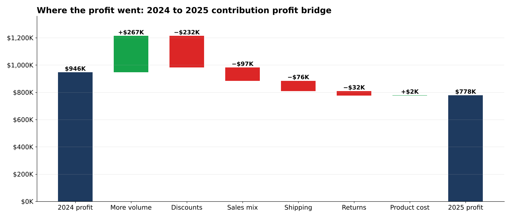
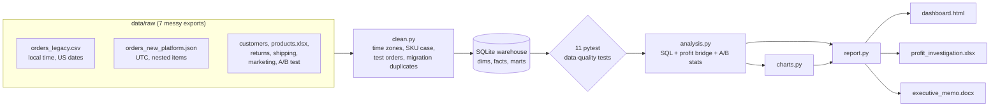

# Where Did the Profit Go?

**An end-to-end analytics project in three acts: a profit investigation, a properly run A/B test, and customer value with a simple ML model. Messy exports to a tested warehouse to three decision memos.**

Harbor & Hearth is an online home-goods store (synthetic data, realistic problems). In 2025 net sales grew **18.8%**, yet contribution profit fell **17.8%**, from $946K to $778K. Leadership asked one question: *where did the profit go?*

This repository answers it, and reproduces every number with one command.



## The answer

| Driver (2024 to 2025) | Effect on contribution profit |
|---|---|
| More volume | +$267K |
| Discounts (sitewide 20% in Q4) | -$232K |
| Sales mix (shift to low-margin Smart Home) | -$97K |
| Shipping (heavy parcels moved to a pricier carrier) | -$76K |
| Returns (one defective lamp batch) | -$32K |
| Product cost | +$2K |
| **Total** | **-$169K** |

Key evidence:

- **The discount did not earn its cost.** A randomized test (6,000 customers) showed 20% off lifted conversion by +0.77 points (p = 0.335, not significant) while cutting product profit by $6.68 per customer (95% CI -$9.65 to -$3.71).
- **Shipping:** from April 2025 heavy orders went to SwiftShip at about twice the cost per order. Extra cost in 2025: $85K.
- **Returns:** the Aurora Standing Lamp return rate went from 2.5% to 23.6%; 246 units came back "Defective - flickering", all sold May to October 2025. Cost: $51K.
- **The old dashboard was wrong too.** Built on the raw exports, it showed 21.8% growth. Orders exported by both systems during a platform migration added about $75K of revenue that never happened.

Full write-up: [`reports/executive_memo.md`](reports/executive_memo.md)


## Act 2: the test that fixes it

A 15-week, three-arm website test (Jan to Apr 2026, `src/generate_experiment.py`, `src/experiment.py`):
A control · B 10% off banner · C new product page (delivery date and reviews by Add to Cart).

- **Planned before launch:** 29,299 visitors per arm (3% baseline, 15% lift, 80% power, Bonferroni for two comparisons).
- **Sample ratio mismatch found and fixed:** arm C had about 2,800 extra rows (p = 9e-35): 2,400 bot rows and 900 visitors seen in two arms. After cleaning: p = 0.21, balanced arms.
- **B (10% off):** conversion +5.5% (p = 0.21, not significant); profit per visitor -$0.97 (97.5% CI -$1.35 to -$0.58): about -$301K a year.
- **C (new page):** conversion +10.6% (p = 0.017, passes 0.025); +21.9% on mobile; profit per visitor +$0.35 (CI -$0.11 to +$0.80), about +$107K a year. Returns unchanged.
- **Peeking:** B's daily p-value was below 0.025 for 14 days in Feb to Mar, then faded. The call was made at the planned end date.

## Act 3: which customers are worth keeping

`sql/analysis/a8_order_profit.sql` rebuilds profit for every order (reconciles to the P&L to the dollar); `src/customers.py`:

- The top 20% of customers earn 60.4% of profit; 241 customers are unprofitable.
- RFM segments, validated with a time-based holdout (set on 30 Jun 2025, watched Jul to Dec): Champions 65% bought again, Hibernating 14%.
- A gradient boosting model, tested on held-out customers: targeting its top 20% reaches 49% of next half-year profit, vs 40% for segments and 20% at random. (Mean absolute error would have picked "predict $0 for everyone": the wrong metric for the decision.)
- Spend guidance per segment, and value by acquisition channel: Paid Social customers earned $211 over two years against $211 of spend per new customer; Email & Referral earned $375 for $96.
- The weak 2025-Q3 cohort: 370 of 725 first orders came from the September discount test, and only 8.4% of them came back.

## Run it

```bash
python -m venv .venv
.venv\Scripts\activate          # Windows   (macOS/Linux: source .venv/bin/activate)
pip install -r requirements.txt
python run_pipeline.py
```

About 20 seconds later, open `reports/dashboard.html`. The pipeline stops at the first failure, so a failing data-quality test never reaches a report.

## How it works



| Step | File | What it does |
|---|---|---|
| 1 | `src/generate_data.py` | Creates the raw exports, with the real-world mess built in (seeded, so results are reproducible) |
| 2 | `src/clean.py` | Combines two order systems, fixes time zones and codes, removes test orders and migration duplicates; logs every fix to `cleaning_log.csv` |
| 3 | `src/load_warehouse.py` + `sql/0*.sql` | Staging tables, then dimensions, facts and marts (star schema) |
| 4 | `tests/test_data_quality.py` | Uniqueness, referential integrity, row-count reconciliation, mart totals match facts |
| 5 | `src/analysis.py` + `sql/analysis/*.sql` | Window functions, cohorts, the profit bridge, a two-proportion z-test and Welch t-test |
| 7 | `src/experiment.py` · `src/customers.py` | Act 2 test analysis and Act 3 customer value, with 5 more tests |
| 8 | `src/charts.py` · `src/charts_more.py` · `src/report.py` | 15 charts, Excel workbook, HTML dashboard, three memos |

## Skills shown

SQL (CTEs, window functions: `RANK`, `FIRST_VALUE`, running share; recursive date dimension) · dimensional modeling · Python/pandas data cleaning · automated data-quality testing · A/B test analysis with confidence intervals · variance (price/volume/mix) analysis · data visualization · stakeholder communication.

## Two bugs I caught (and what they taught me)

1. **Deduplication that deleted real sales.** My first rule treated rows with the same order, SKU, quantity and price as duplicates. It removed 141 legitimate lines (customers really do buy two separate identical lines). The fix was to deduplicate at the *order* level: if an order exists in the new platform, drop its legacy copy. Lesson: define a duplicate from the business process, not from matching columns.
2. **A join that double-counted refunds.** Joining returns to order lines on order id and SKU multiplied returns whenever an order had the same SKU on two lines (1,793 rows instead of 1,755). The fix was to compute a per-unit price per order and SKU first, then join. A row-count test (`fact_return` must equal staging) now guards it.

## Repository map

```
run_pipeline.py          one command for everything
src/                     python steps (config, generate, clean, load, analysis, charts, report)
sql/                     warehouse build (01-03) and analysis queries (a1-a7)
tests/                   data-quality tests
data/raw, data/processed generated inputs and cleaned outputs
warehouse/               harbor_hearth.db (SQLite)
reports/                 charts, dashboard, workbook, memo, findings.json
docs/                    data dictionary, decision log
```

*All company names, products and figures are synthetic. The problems are real ones.*
